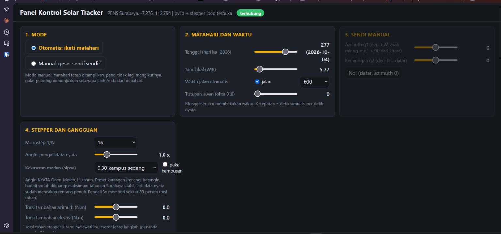

# Two-Axis Solar Tracker PENS: Simulation and Cyber-Physical System

A validated Digital Model of a two-axis solar tracker (azimuth and tilt) at Politeknik Elektronika Negeri
Surabaya, located at `-7.276006, 112.794327`. MOS C-50-18-M 50 W panel, two 57HSE3.0N stepper motors coupled
directly to the shafts with no gearbox, four baffled LDRs at the panel edges.

Applied Master's thesis, Cyber-Physical Systems course.

> Code identifiers, launch arguments, ROS topic fields and most source files are in Indonesian, because that
> is what the running system uses. This README is the English entry point; renaming identifiers would break
> the simulation. A short glossary is at the bottom.



Browser-based control panel (`solar_tracker/control_web.py`, open `http://localhost:8765`). Every simulation
parameter can be changed while Gazebo is running: date, hour, time speed, cloud cover, microstep, real-wind
multiplier, and disturbance torque.


The model in Gazebo. The panel rolls left and right about the rails (it does not pitch along them), the red
ball marks the sun direction computed by pvlib, and the shadow shows the true angle of incidence.


The real hardware, 28 September 2026. Two stacked 57HSE3.0N motors: the lower one rotates azimuth, the upper
one tilts the panel about the rails. Both are coupled directly to the shafts with no gearbox. The panel, the
LDRs and the power wiring are not yet mounted. This is the rig that has to be measured to replace the
assumed parameters.

> **Design change pending in the model.** The motors have since moved to **closed-loop** drivers with shaft
> encoders. Everything in this repo still models the open-loop stepper. The impact is analysed in
> `dinamika/loop_tertutup_results.md`: the system becomes stiffer but **less damped** (azimuth 4.79 to
> 16.4 Hz, zeta 0.0220 to 0.0064), and the **ZVD input shaper must be retuned** or it loses most of its
> effect. Step loss disappears; static misalignment does not, because the encoder sits on the rotor and
> cannot see shaft twist or mounting error.

---

## What exists today

| Layer | Contents | Status |
|---|---|---|
| Kinematics | panel normal vector, inverse kinematics, Jacobian, keyhole effect | validated against Gazebo |
| Dynamics | two-joint Euler-Lagrange, inertia from CAD, gravity, friction | validated against Gazebo |
| Actuator | open-loop stepper, sinusoidal torque-angle law, microstep quantisation | Python model and Gazebo |
| Control | pvlib SPA feedforward, trapezoidal profile, ZVD input shaper | measured in Gazebo |
| Sensing | four-quadrant LDR, single-diode panel model, current as a sensor | model only, no hardware yet |
| Estimator | EKF estimating joint offset, encoder replacement | measured, closed loop optional |
| Disturbance | real directional wind, Open-Meteo, 11 years | validated against Gazebo |
| Monitoring | web panel, RViz, time plots, wind compass | running |

### Measured results

| Quantity | Value | How it was obtained |
|---|---|---|
| Sun position | difference < 0.011 deg | pvlib SPA vs astropy, SolTrack, Pysolar |
| Panel normal kinematics | difference 0.14 to 0.34 deg | Gazebo TF vs `tracker.fk` |
| Gravity deflection at q2 = 0 | 0.161 measured vs 0.155 predicted | Gazebo |
| Azimuth natural frequency | 4.79 predicted, 5.19 measured Hz | eigenvalues vs Gazebo at 1 kHz |
| Overshoot on a 1 deg step | 93.3 % theory, 90 % measured | analytic vs Gazebo |
| ZVD cuts worst-case overshoot | 19.35 down to 2.30 deg | Gazebo, five repeats |
| Energy lost to oscillation | 0.007 % | two-axis model at 1 kHz |
| Daily energy, 7 Oct | 431.0 Wh tracked vs 362.3 Wh flat | single-diode model |
| Worst 11-year wind margin | 9.2 % of holding torque | Open-Meteo + directional model |
| EKF with calibrated LDRs | 2.52 down to 0.18 deg | full-day simulation |
| Recovery from a 7.2 deg step loss | 350 seconds | full-day simulation |

---

## Read these first

| File | Contents |
|---|---|
| **`sistem_cps_tracker_pens.pdf`** | **Start here.** 19 pages (in Indonesian), every physics equation with the name of its model, the three-layer CPS architecture, and where this sits relative to a Digital Twin. LaTeX source in `.tex`, markdown version in `.md`. |
| `parameter_kinematik.md` | Master document, 18 sections. Every parameter, where it came from, and the decision history. |
| `parameter_asumsi_dan_pengukuran.md` | The ~31 parameters still assumed, and how to measure each one on the real rig. |
| `solar_tracker/README_gazebo.md` | Gazebo model details, topics and commands. |

---

## Running the simulation

Environment: **Windows + WSL (Ubuntu)**, ROS 2 Lyrical, Gazebo (gz sim 10.5.0).

### One-time setup

```bash
# symlink so the path has no spaces (Gazebo and ROS dislike spaces)
ln -s "/mnt/c/Magister PENS/Semester 2/cyberphysicalsystem/modelkinematik" ~/mk

# venv for offline studies (no ROS)
python3 -m venv ~/.venvs/solar
~/.venvs/solar/bin/pip install pvlib scipy trimesh pysolar numpy pandas

# venv for the ROS nodes (needs rclpy from the system packages)
python3 -m venv --system-site-packages ~/.venvs/solar-ros
~/.venvs/solar-ros/bin/pip install pvlib

source /opt/ros/lyrical/setup.bash
```

### Rebuilding the model from CAD

```bash
cd ~/mk && ~/.venvs/solar/bin/python build_model.py
```

Reads `New folder (2)/solar_stl/parts_v2/*.stl` and writes `solar_tracker/solar_tracker.urdf` plus three link
meshes into `solar_tracker/meshes/`. Masses and inertias come from `inersia/inersia_link.json`.

### Launching

```bash
# basic: Gazebo + ros_gz bridge + robot_state_publisher
ros2 launch ~/mk/solar_tracker/launch/sim.launch.py

# full: pvlib sun node, sensors, EKF, RViz, web control panel
ros2 launch ~/mk/solar_tracker/launch/sim.launch.py \
    sun_node:=true ekf:=true rviz:=true panel:=true \
    date:=2026-10-07 speed:=600 kalibrasi:=true

# open-loop stepper model (can lose steps) with real wind at 3x
ros2 launch ~/mk/solar_tracker/launch/sim.launch.py \
    actuator:=stepper sun_node:=true panel:=true skala_angin:=3.0

# closed loop: sun commands CORRECTED by the EKF estimate
ros2 launch ~/mk/solar_tracker/launch/sim.launch.py \
    sun_node:=true ekf:=true pakai_ekf:=true panel:=true
```

The control panel opens itself in the Windows browser at `http://localhost:8765`.

### Launch arguments

Argument names are Indonesian because they are the actual parameter names in the code.

| Argument | Default | Meaning |
|---|---|---|
| `actuator` | `pid` | `pid` = Gazebo position control tuned to the stepper plus shaft series stiffness; `stepper` = open-loop stepper model, can lose steps |
| `sun_node` | `false` | run the pvlib sun command node |
| `date`, `speed`, `okta` | `2026-10-04`, `600`, `0` | date, simulated seconds per real second, cloud cover in oktas |
| `skala_angin` | `1.0` | multiplier on the REAL wind data. `3.0` reaches about 83 % of holding torque |
| `alpha_angin` | `0.30` | wind profile exponent (0.16 open field, 0.35 dense campus) |
| `tanggal_angin` | `2026-10-07` | which real wind day to replay (data spans 2015 to 2026) |
| `mism` | `0.03` | LDR-to-LDR mismatch. `0.03` = uncalibrated |
| `kalibrasi` | `false` | `true` = LDR mismatch removed (procedure A, perfect) |
| `ekf` | `false` | run `ekf_node`, publish `/ekf/state` |
| `pakai_ekf` | `false` | `sun_command_node` USES the EKF correction (closed loop). Requires `ekf:=true` |
| `rviz`, `panel`, `headless` | `false` | visualisation and no-GUI mode |

### Traps already discovered

These are real, not theoretical. They will save you hours.

- **Gazebo dies when the `wsl.exe` session that started it ends.** Run `ros2 launch` in a terminal you keep open.
- **Never kill a single node managed by `ros2 launch`.** `pkill -9 -f control_web.py` takes the whole launch down.
- The Gazebo server process is called `gz-sim-main`, not `gz sim`. `pkill -f "gz sim"` does not kill it.
- `ros2 param set` with a date needs double then single quotes: `"'2026-06-21'"`. Without them the CLI parses it as a YAML date and crashes.
- **`use_sim_time` is mandatory on every node.** Without it the motion profile and input shaper run on wall-clock time while the plant runs on simulation time (Gazebo is roughly 85 % real-time), and overshoot stops being reproducible.
- **WSL here has no internet access, Windows does.** Download data via PowerShell, process it in WSL.
- The web panel re-reads `control_web.html` on every request, so editing the HTML only needs a browser refresh.

---

## File map

### Model core

| File | Contents |
|---|---|
| `sun.py` | sun position and irradiance for PENS (pvlib SPA, Ineichen, Kasten-Czeplak, Erbs) |
| `tracker.py` | `fk`, `sun_vec`, `ik_track`. `HEAD = 90 deg`, `Q2_MAX = 45 deg` |
| `build_model.py` | parts_v2 CAD into three link meshes and a URDF |
| `inersia/inersia_cad.py` | mass, centre of mass and inertia tensor per link from the meshes. Writes `inersia_link.json` |
| `dinamika/dyn_model.py` | single-axis dynamics, stepper model, shaft stiffness |
| `dinamika/osilasi_energi.py` | two-axis oscillation at 1 kHz and its effect on energy |

### Hybrid control and sensing

| File | Contents |
|---|---|
| `kontrol_hibrid/hybrid_sim.py` | four-quadrant LDR model and hybrid control |
| `kontrol_hibrid/panel_listrik.py` | five-parameter single-diode model fitted to the nameplate |
| `kontrol_hibrid/sensor_arus.py` | current measurement chain and its two fundamental limits |
| `kontrol_hibrid/fusi_sensor.py` | per-sensor uncertainty, noise vs bias separation, fusion weights |
| `kontrol_hibrid/ekf.py` | extended Kalman filter, joint offset estimator |
| `kontrol_hibrid/kalibrasi_ldr.py` | calibration procedure A (diffuse light) and B (full-day regression) |

### Real wind

| File | Contents |
|---|---|
| `angin/angin_openmeteo.py` | loading, height correction, directional torque model |
| `angin/angin_pens_2015-2026.csv` | 102,984 hours of Open-Meteo data for the PENS site |

CSV columns: `waktu` (timestamp), `v10_ms` (hourly mean wind speed at 10 m), `hembusan10_ms` (peak gust within
that hour), `arah_deg` (compass bearing the wind comes **from**; it blows toward that bearing + 180).

### Gazebo simulation and ROS 2 nodes

| File | Contents |
|---|---|
| `solar_tracker/world.sdf`, `world_stepper.sdf` | Gazebo worlds, gravity 10 m/s2 |
| `solar_tracker/launch/sim.launch.py` | main launch file, all arguments above |
| `solar_tracker/sun_command_node.py` | pvlib commands, trapezoidal profile, ZVD input shaper |
| `solar_tracker/stepper_node.py` | open-loop stepper model applying torque to the joints |
| `solar_tracker/wind_node.py` | real directional wind, publishes `/wind/state` |
| `solar_tracker/sensor_node.py` | LDRs, single-diode model, energy, error breakdown to `/tracker/diag` |
| `solar_tracker/ekf_node.py` | offset estimator, publishes `/ekf/state` and `/ekf/koreksi` |
| `solar_tracker/control_web.py` + `.html` | browser control panel |
| `solar_tracker/rec_*.py` | recording scripts for specific experiments |

---

## Status: Digital Model, not yet a Digital Twin

By the Kritzinger taxonomy:

| Level | Data flow | Position |
|---|---|---|
| **Digital Model** | none, manual | **here** |
| Digital Shadow | automatic, physical to digital | not yet |
| Digital Twin | automatic, bidirectional | not yet |

What exists is a Digital Model **cross-validated three ways**: analytic eigenvalues, the two-axis Python
model, and Gazebo all agree. What does not exist is any link to the physical rig.

**The bridge is short.** `sensor_node` generates sensor data and publishes it to `/tracker/diag`; `ekf_node`
consumes it from that topic. Replacing `sensor_node` with a hardware reader node that publishes the same
message makes the entire chain behind it run unchanged.

---

## What to do next

Ordered by value.

### 1. Free decay test on the real rig

The single most valuable experiment. Push the panel one step, record the ringing, and that one recording
yields all of these at once:

- natural frequency, from the ringing period
- joint damping `b`, from the ratio of successive peaks via `zeta = -ln(ratio) / 2 pi`
- Coulomb friction `tau_c`, from the residual offset that never returns to zero
- shaft stiffness `k`, from the frequency and the inertia already known from CAD

Four of the largest assumed parameters disappear in one experiment. Every dynamics result in this repo
depends on them.

### 2. LDR curve and calibration

Measure the lux-to-voltage curve on the bench to obtain `gam` and `L0`, then run procedure A under heavy
overcast. **This is not optional.** Uncalibrated LDRs make the EKF **worse** than using no LDRs at all
(5.63 deg vs 2.52 deg), because LDR bias is indistinguishable from mechanical misalignment.

### 3. Instrumentation toward a Digital Shadow

1. A microcontroller reads the four LDRs and the panel current, sends them over serial.
2. A serial reader node publishes to `/tracker/diag` in the same format as `sensor_node`.
3. Close the loop to the stepper driver. **That is the Digital Twin.**

### 4. Measure the rest

See `parameter_asumsi_dan_pengukuran.md`. The most consequential after the three above: maximum tilt limit
(assumed 45 deg), rail heading with a compass (assumed North), ground albedo at the site (assumed 0.25, which
shifts the current peak by up to 2.75 deg), and motor mass (assumed 1.2 kg).

### 5. Not yet modelled

The Coriolis term (magnitude already computed: 0.0000 % while tracking, 3.4 % at 90 deg/s slew), network
latency and jitter, event-triggered control, online parameter identification, a health index from friction
drift, structural fatigue cost, coupling backlash, and frame vibration modes.

---

## Warnings for whoever continues

**Retracted results.** Do not reuse these:

1. The 9.6 m/s azimuth pull-out wind limit. It depended on a guessed moment arm; the true range is 6.5 to
   39.4 m/s.
2. The +2.6 deg current peak shift. It used inconsistent irradiance values. The correct answer is -2.75 to
   +2.75 deg depending on albedo.
3. The synthetic wind scenarios (`tenang`, `berangin`, `badai` = calm, windy, storm). Two to three times too
   severe, as proven by the 11-year data. Already removed from the live path and replaced by a multiplier on
   real data.

**Stale results.** Computed with a 1.5 kg, 0.44 x 0.30 m panel, g = 9.81, and the old hinge axis. Re-run the
scripts before citing: `dinamika/dyn_results.md`, `gabungan/coupled_results.md`, `gabungan/stow_results.md`,
`kontrol_hibrid/hybrid_results.md`, and everything under `robustness/` and `skenario_cuaca/`. Two stale
numbers also remain in `solar_tracker/README_gazebo.md` (panel 1.5 kg and elevation axis `+y`); the values
that actually apply are a 2.55 kg panel and axis `(1,0,0)` along the rails.

`gabungan/coupled_sim.wind_series` is marked **DEPRECATED** but kept so the older offline studies still run.

**The authoritative sources** are `sistem_cps_tracker_pens.pdf` and `parameter_kinematik.md`.

---

## Not in this repo

- `jurnalrandom/` holds third-party journal PDFs. Not uploaded: they are copyrighted and this repo is public.
  How their content maps onto this system is documented in `sistem_cps_tracker_pens.pdf`.
- Python environments (`.venv/`), raw experiment logs, and the large CAD dumps already superseded by
  `parts_v2`. See `.gitignore`.

---

## Glossary of Indonesian identifiers

| Indonesian | English |
|---|---|
| `angin` | wind |
| `arah` | direction, bearing |
| `dinamika` | dynamics |
| `fusi_sensor` | sensor fusion |
| `gabungan` | coupled, combined |
| `hembusan` | gust |
| `inersia` | inertia |
| `kalibrasi` | calibration |
| `kontrol_hibrid` | hybrid control |
| `koreksi` | correction |
| `mism` | LDR-to-LDR mismatch |
| `okta` | cloud cover in oktas (0 to 8) |
| `osilasi_energi` | oscillation and energy |
| `pakai_ekf` | use the EKF |
| `panel_listrik` | panel electrical model |
| `sensor_arus` | current sensor |
| `skala` | scale, multiplier |
| `skenario_cuaca` | weather scenarios |
| `tanggal` | date |
| `waktu` | time, timestamp |

## Licence

Not yet decided. Thesis work, please contact the author before reusing.
